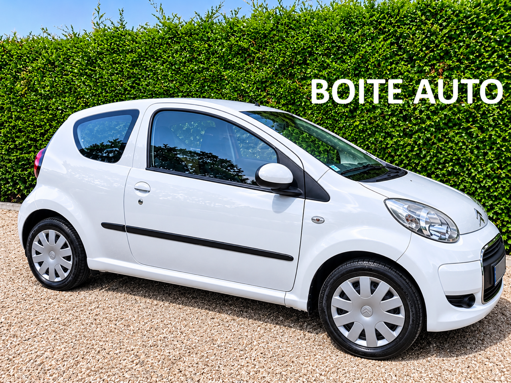
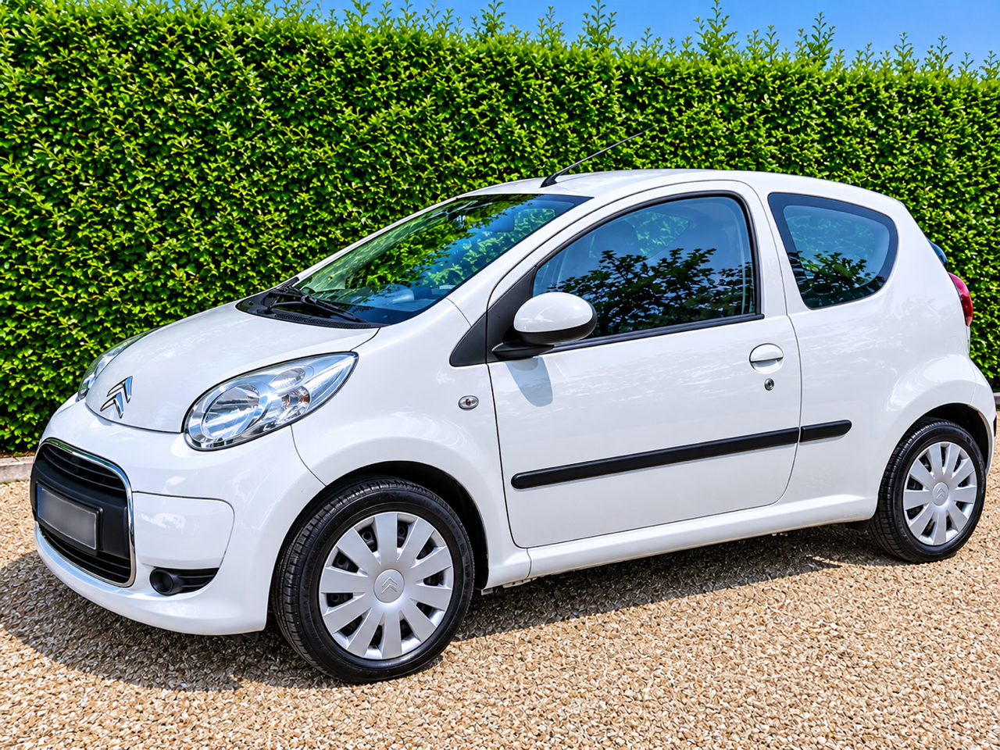
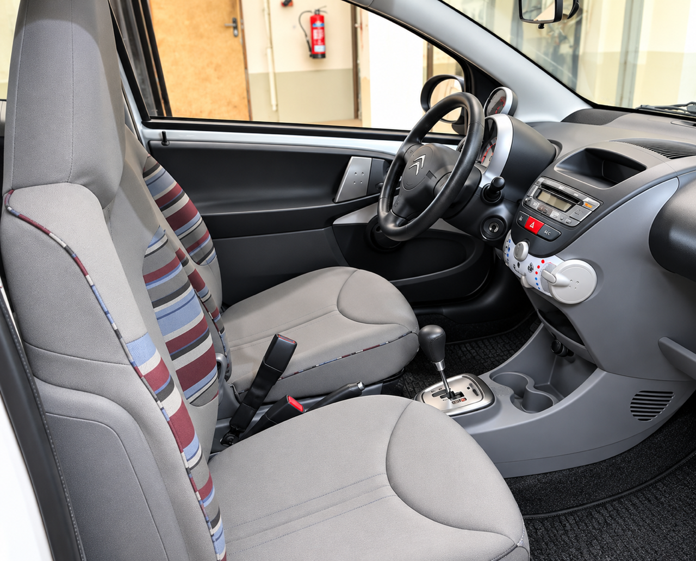

+++
title = "CITROEN C1 Essence BVA 68 Blanche 3p clim "
description = "CITROEN C1 Essence BVA 68 Blanche 3p clim "
tags = [
]
date = "2026-11-10"
categories = [
    "Voitures"
]
image = "../post/20261110_citroen_c1_bva_2011_blanche_3p_77mkm/images/1.jpg"
adate = "2011"
akm = "77 000km"
agaz = "essence"
aboite = "auto"
apuissance= "68 CV"
acouleur = "blanche"
prix="6700"

+++

# CITROEN C1 Essence BVA 68 Blanche 3p clim


 

CITROEN C1 Essence BVA 68 Blanche 3p clim affichant 77.000 km

### EQUIPEMENTS :
Climatisation, Verrouillage centralisé avec télécommande, Compte tours, Direction assistée , RADIO CD ( possibilité de CARPLAY Bluetooth en option), Vitres avant électriques, Airbags, Sièges arrières ISOFIX, Banquette arrière rabattable, véritable roue de secours etc..
Liste d'options à valider avec un commercial lors de votre visite

### CARROSSERIE :
Bel état  général 

### INTERIEUR :
Tissu très propre

### MECANIQUE :
Entretien à jour ( vidange + filtres fait en 10/26)
Moteur TOYOTA à chaîne ( pas de Courroie de distribution)

Double des clés
Consommation : 4L/100km
Véhicule économe

Contrôle technique OK 

Aucun frais à prévoir

### PRIX : 6700 Euros

Disponible sous 15 jours
Garantie 6 mois

<!-- more -->

